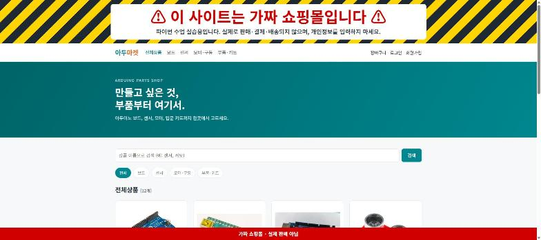
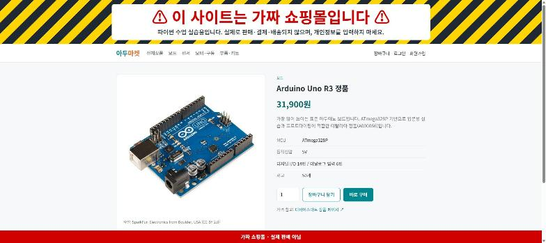

# 아두마켓 (auduino-market)

> # ⚠️ 이 사이트는 가짜 쇼핑몰입니다
> 파이썬 수업 실습용으로 만든 **연습용 사이트**입니다.
> 실제로 판매·결제·배송되지 않으며, 진짜 개인정보(이름·연락처·주소)를 입력하지 마세요.

아두이노 보드·센서·모터·부품을 파는 **가상의 쇼핑몰**입니다.
파이썬(Flask)으로 서버를 만들고, 데이터는 Supabase에 저장하고, Vercel로 인터넷에 배포했습니다.

- **사이트 주소:** https://auduino-market.vercel.app
- **만든 날:** 2026-10-13 (청년 피지컬 AI · 수업2 파이썬 기초)

| 메인 화면 | 상품 상세 |
|---|---|
|  |  |

---

## 1. 가짜 사이트 소개

### 이런 걸 할 수 있어요

| 손님 | 관리자 |
|---|---|
| 상품 목록 보기, 카테고리별 보기, 이름으로 검색 | 상품 등록·수정·삭제 (사진 업로드 포함) |
| 상품 상세 (사양, 재고, 가격 참고 링크) | 전체 주문 보기 |
| 회원가입·로그인·로그아웃 | 주문 상태 바꾸기 (주문완료 → 배송준비 → 배송중 → 배송완료 / 주문취소) |
| 장바구니 담기·수량 변경·삭제 (재고보다 많이 못 담음) | |
| 주문하기 (**가짜 결제**, 주문하면 재고가 자동으로 줄어듦), 주문내역 | |

### 가짜라는 표시
- 모든 페이지 **맨 위**에 노랑·검정 경고 줄무늬와 큰 빨간 글씨로 "이 사이트는 가짜 쇼핑몰입니다"
- 모든 페이지 **맨 아래**에 스크롤해도 따라오는 빨간 띠 "가짜 쇼핑몰 · 실제 판매 아님"
- **주문하기** 화면의 결제 버튼 바로 위에 "가짜 결제입니다" 경고

### 판매 상품 (12개)
가격은 **디바이스마트 판매가(VAT 포함, 2026-10-13 확인)** 를 참고했습니다. 재고 수량은 임의로 정한 값입니다.

| 카테고리 | 상품 | 가격 | 참고 페이지 |
|---|---|---:|---|
| 보드 | Arduino Uno R3 정품 | 31,900원 | [디바이스마트](https://www.devicemart.co.kr/goods/view?no=34404) |
| 보드 | Arduino Nano 정품 | 37,400원 | [디바이스마트](https://www.devicemart.co.kr/goods/view?no=34411) |
| 보드 | Arduino Mega 2560 R3 정품 | 64,900원 | [디바이스마트](https://www.devicemart.co.kr/goods/view?no=34405) |
| 센서 | HC-SR04 초음파 거리센서 | 1,210원 | [디바이스마트](https://www.devicemart.co.kr/goods/view?no=1076851) |
| 센서 | DHT11 온습도 센서 모듈 | 7,260원 | [디바이스마트](https://www.devicemart.co.kr/goods/view?no=1383893) |
| 센서 | HC-SR501 PIR 인체감지 센서 | 2,970원 | [디바이스마트](https://www.devicemart.co.kr/goods/view?no=10825465) |
| 모터·구동 | SG90 미니 서보모터 | 2,090원 | [디바이스마트](https://www.devicemart.co.kr/goods/view?no=1128421) |
| 모터·구동 | 28BYJ-48 스텝모터 + ULN2003 드라이버 | 2,310원 | [디바이스마트](https://www.devicemart.co.kr/goods/view?no=1327608) |
| 모터·구동 | L298N 모터드라이버 모듈 | 2,970원 | [디바이스마트](https://www.devicemart.co.kr/goods/view?no=1278835) |
| 부품·키트 | 브레드보드 830핀 (MB-102) | 1,540원 | [디바이스마트](https://www.devicemart.co.kr/goods/view?no=1322408) |
| 부품·키트 | 점퍼케이블 40P (M/M) 20cm | 935원 | [디바이스마트](https://www.devicemart.co.kr/goods/view?no=1321196) |
| 부품·키트 | 아두이노 스타터 키트 (한글판) | 152,900원 | [디바이스마트](https://www.devicemart.co.kr/goods/view?no=1149109) |

### 상품 사진
- 12장 모두 **자유 라이선스(Creative Commons) 실제 제품 사진**입니다. 도형으로 그리거나 AI로 만든 그림은 쓰지 않았습니다.
- 디바이스마트의 사진은 쓰지 않았습니다. (저작권 때문)
- 사진마다 저작자·라이선스는 [static/images/products/CREDITS.md](static/images/products/CREDITS.md)와 사이트의 **"이미지 출처"** 페이지에 있습니다.
- 몇몇 사진은 판매 제품과 모양이 조금 다릅니다. (초음파 센서는 빨간 보드, 나노는 호환 보드, 점퍼케이블은 낱개 전선 사진)

---

## 2. 사용한 기술

| 역할 | 사용한 것 |
|---|---|
| 서버 | Python + [Flask](https://flask.palletsprojects.com/) |
| 화면 | HTML (Jinja 템플릿) + CSS + 약간의 JavaScript |
| 데이터베이스·로그인·이미지 저장소 | [Supabase](https://supabase.com) (PostgreSQL, Auth, Storage) |
| 배포 | [Vercel](https://vercel.com) |
| 글꼴 | [Google Fonts](https://fonts.google.com) – Noto Sans KR |

### 폴더 구조
```
├── app.py                 # 서버 시작 파일 (페이지 묶음 등록, 공통 기능)
├── supabase_client.py     # Supabase 연결을 한곳에서 관리
├── supabase_connect.py    # 처음에 연결을 시험해 본 파일
├── routes/                # 기능별 서버 코드
│   ├── products.py        #   상품 목록·상세·이미지 출처
│   ├── auth.py            #   회원가입·로그인·로그아웃
│   ├── cart.py            #   장바구니
│   ├── orders.py          #   주문하기·주문내역
│   ├── admin.py           #   관리자 (상품·주문 관리)
│   └── helpers.py         #   로그인 확인 등 공통 도구
├── templates/             # HTML 화면 (admin/ 은 관리자 화면)
├── static/                # CSS, JS, 상품 사진
├── database/
│   ├── schema.sql         # 테이블·보안 규칙·주문 함수를 만드는 SQL
│   ├── seed.py            # products.json 의 상품을 DB에 넣는 코드
│   └── products.json      # 상품 12개 정보 (디바이스마트 기준)
├── docs/                  # README용 스크린샷
├── requirements.txt       # 필요한 파이썬 패키지
├── vercel.json            # Vercel에 "Flask 앱"이라고 알려 주는 설정
└── .env.example           # 비밀키 넣는 파일(.env)의 예시
```

### 데이터베이스 구조 (Supabase)
| 테이블 | 내용 |
|---|---|
| `categories` | 카테고리 (보드, 센서, 모터·구동, 부품·키트) |
| `products` | 상품 (이름, 가격, 재고, 설명, 사양, 사진, 사진 출처) |
| `profiles` | 회원 이름, 관리자 여부 (로그인 계정은 Supabase Auth에 저장) |
| `cart_items` | 장바구니 |
| `orders` / `order_items` | 주문과 주문한 상품 (주문 당시 이름·가격을 그대로 남김) |

- **보안(RLS):** 상품과 카테고리는 누구나 읽을 수 있고, 장바구니·주문·회원 정보는 서버만 다룰 수 있습니다.
- **주문 함수 `place_order`:** 재고 확인 → 주문 만들기 → 재고 줄이기 → 장바구니 비우기를 한 번에 처리해서, 중간에 오류가 나도 데이터가 꼬이지 않습니다.

---

## 3. 만든 과정

### 0단계: Supabase 연결
1. `supabase`, `python-dotenv` 패키지를 설치하고, 주소와 키를 `.env` 파일에 넣었습니다.
2. `supabase_connect.py`로 연결을 시험했습니다.
   - **문제:** 주소 끝에 `/rest/v1/`이 붙어 있어 "잘못된 주소" 오류가 났습니다. → 주소를 `https://프로젝트.supabase.co`까지만 쓰니 해결됐습니다.
   - **문제:** 테이블을 읽었는데 빈 결과 `[]`만 나왔습니다. → Supabase의 **RLS(행 수준 보안)** 때문이었고, 읽기 규칙(policy)을 추가하니 데이터가 나왔습니다.

### 1단계: 계획과 폴더 구조
- 기능 목록, 테이블 설계, 진행 순서를 먼저 정하고 폴더 뼈대를 만들었습니다.
- Flask 기본 화면(공통 레이아웃, 메인 화면, 디자인)을 만들고 `python app.py`로 실행해 확인했습니다.

### 2단계: Supabase 관리 권한 연결
- 처음에는 **Supabase MCP**로 연결하려 했지만, 대화 도중에 등록한 MCP는 프로그램을 다시 켜야 보여서 쓰지 못했습니다.
- 대신 **Supabase 개인 액세스 토큰**으로 관리 API를 써서 SQL을 실행했습니다.
  - **문제:** 처음 만든 토큰에 권한이 없어 `Missing required permission` 오류가 났습니다. → 권한을 주고 다시 만들어 해결했습니다.
  - **문제:** `.env`의 공개 키 뒤에 다른 글자가 붙어 있어 `Invalid API key` 오류가 났습니다. → 올바른 공개 키로 고쳤습니다.

### 3단계: 상품 정보와 사진 모으기
- 디바이스마트 상품 페이지에서 상품 12개의 이름과 가격을 확인했습니다.
- 위키미디어 공용(Wikimedia Commons)과 Flickr에서 자유 라이선스 실제 사진을 받고 출처를 기록했습니다.

### 4단계: 데이터베이스와 사이트 기능 만들기
- `database/schema.sql`로 테이블 6개, 보안 규칙, 주문 함수, 이미지 저장소(Storage 버킷)를 만들었습니다.
- `database/seed.py`로 카테고리 4개와 상품 12개를 넣었습니다.
- 상품 목록·상세·검색, 회원가입·로그인, 장바구니, 주문, 관리자 페이지를 만들었습니다.
- 회원가입 → 장바구니 → 주문 → 관리자 기능까지 **자동 테스트 코드로 전체 흐름을 확인**하고, 테스트로 만든 데이터는 지웠습니다.

### 5단계: "가짜 사이트" 표시
- 사이트를 실제 쇼핑몰로 오해하지 않도록 맨 위·맨 아래·결제 화면에 큰 경고를 넣었습니다.

### 6단계: Vercel 배포
- `requirements.txt`에 패키지 버전을 고정하고, `.vercelignore`로 `.env`가 올라가지 않게 막았습니다.
- 비밀키는 Vercel의 환경 변수(숨김 설정)에 따로 넣었습니다.
  - **문제:** 첫 배포 후 이미지·CSS만 열리고 나머지 페이지는 404가 났습니다. → 파이썬 서버가 실행되지 않은 것이었고, `vercel.json`에 `"framework": "flask"`를 넣어 다시 배포하니 해결됐습니다.
- 배포된 사이트에서도 전체 기능 테스트를 다시 통과했습니다.

---

## 4. 제작에 도움 받은 사이트·도구

| 이름 | 어디에 썼나 |
|---|---|
| [Supabase](https://supabase.com) | 데이터베이스, 회원 로그인(Auth), 이미지 저장소(Storage), 관리 API |
| [Vercel](https://vercel.com) | 사이트 배포 (https://auduino-market.vercel.app) |
| [디바이스마트](https://www.devicemart.co.kr) | 상품 이름·가격·사양 참고 |
| [Wikimedia Commons](https://commons.wikimedia.org) | 상품 사진 10장 (CC BY / CC BY-SA) |
| [Flickr](https://www.flickr.com) | 상품 사진 2장 (L298N, 스타터 키트 · CC BY-SA 2.0) |
| [Google Fonts](https://fonts.google.com) | Noto Sans KR 글꼴 |
| [Flask](https://flask.palletsprojects.com) | 파이썬 웹 서버 |
| [supabase-py](https://github.com/supabase/supabase-py) | 파이썬에서 Supabase 사용 |
| [GitHub](https://github.com) | 코드 저장 |
| [Claude Code](https://claude.com/claude-code) (Anthropic) | AI 코딩 도우미 – 계획, 코드 작성, 테스트, 배포를 함께 진행 |

---

## 5. 내 컴퓨터에서 실행하기

```bash
# 1. 패키지 설치
pip install -r requirements.txt

# 2. .env.example 을 복사해서 .env 를 만들고 Supabase 값 채우기

# 3. Supabase SQL Editor 에서 database/schema.sql 실행 (테이블 만들기)

# 4. 상품 넣기
python database/seed.py

# 5. 서버 실행 → 브라우저에서 http://127.0.0.1:5000
python app.py
```

관리자 계정은 Supabase에서 해당 회원의 `profiles.is_admin` 값을 `true`로 바꾸면 됩니다.

> `.env` 파일(비밀키)은 절대 GitHub에 올리지 마세요. 이 저장소에는 `.env.example`(빈 예시)만 들어 있습니다.

---

## 6. 저작권·라이선스
- **코드:** 수업 실습용으로 자유롭게 참고해도 됩니다.
- **상품 사진:** 각 사진의 원저작자에게 저작권이 있으며 표시된 Creative Commons 라이선스를 따릅니다. 자세한 내용은 [CREDITS.md](static/images/products/CREDITS.md)를 보세요.
- **상품명·가격:** 디바이스마트 판매 정보를 참고했을 뿐, 이 사이트는 디바이스마트·Arduino와 관계없는 **가짜 연습용 사이트**입니다.
